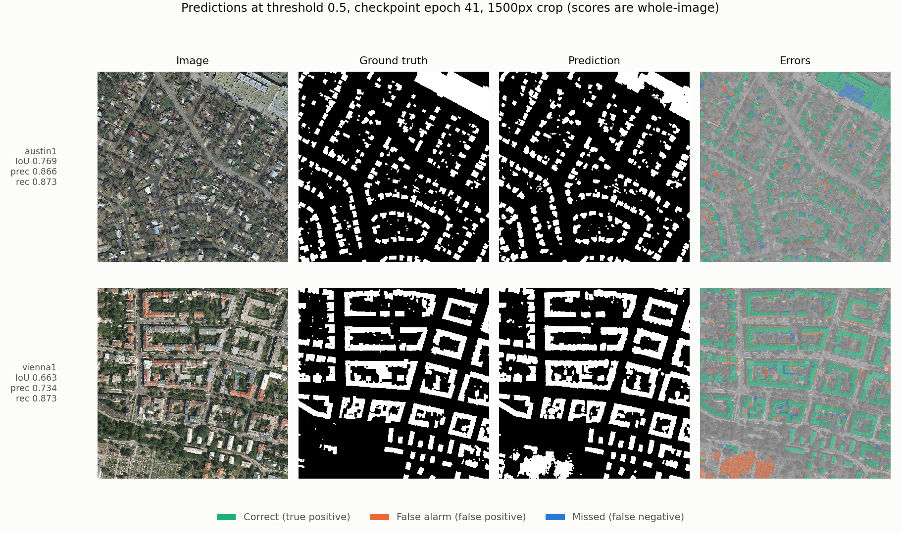
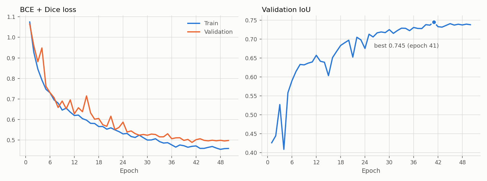

# Aerial Building Segmentation

Building footprint segmentation in aerial imagery with a **U-Net written from
scratch in PyTorch**, trained on a subset of the Inria Aerial Image Labeling
Dataset. It reaches **0.757 IoU** on held-out images, matching an
ImageNet-pretrained ResNet-34 baseline at a third of the parameters.



## Results

Sliding window over whole 5000×5000 px images, 6 test images never used for
any decision.

| | IoU | Precision | Recall |
|---|---|---|---|
| **Overall** | **0.757** | 0.857 | 0.865 |
| Austin (~15% buildings) | 0.764 | 0.875 | 0.858 |
| Vienna (~32% buildings) | 0.752 | 0.848 | 0.870 |

Per image 0.663 – 0.813. 50 epochs, ~45 min on a Quadro RTX 5000; the checkpoint
is the best validation epoch (41).



## Benchmark

Identical data, splits, seed and schedule — only the model changes.

| Model | Params | Val IoU | Test IoU |
|---|---|---|---|
| U-Net from scratch | 7.76 M | 0.745 | 0.757 |
| U-Net + ResNet-34 (ImageNet) | 24.4 M | 0.750 | 0.764 |
| DeepLabV3+ + ResNet-34 (ImageNet) | 22.4 M | 0.737 | 0.755 |

The 0.010 spread is within the epoch-to-epoch jitter of a single run (sd
0.002–0.004), so this experiment cannot separate the three models. That would
need several seeds per architecture.

## Design decisions

- **Split by whole image**, not tile — neighbouring tiles are near-duplicates.
- **Drop 90% of empty tiles in training only**; validation and test keep all.
- **Normalization per architecture** — pretrained encoders get ImageNet stats.
- **Score full images**, pooled over pixels; report per city and per image.
- **Threshold fixed at 0.5** and checkpoint chosen on validation, never test.

## Running

```bash
pip install -r requirements.txt
python scripts/download_data.py      # ~2.1 GB
python scripts/make_tiles.py
python -m src.train                  # ~45 min on a 16 GB GPU
python -m src.evaluate --set test
```

A benchmark run needs its own output paths, or it overwrites the U-Net's:

```bash
python -m src.train --arch unet_resnet34 --out runs/unet_resnet34
python -m src.evaluate --set test --checkpoint runs/unet_resnet34/best.pt \
  --predictions runs/unet_resnet34/predictions_test \
  --out results/benchmark/unet_resnet34/metrics_test.json
```

All settings are in [configs/default.yaml](configs/default.yaml).

The [notebooks](notebooks/) walk through the development process step by step.

## Data

[Inria Aerial Image Labeling Dataset](https://project.inria.fr/aerialimagelabeling/),
0.3 m/px, not stored here. Austin and Vienna, 500×500 tiles:

| Split | Image ids | Images | Tiles |
|---|---|---|---|
| Train | 6–15 | 20 | 1,876 |
| Validation | 4–5 | 4 | 400 |
| Test | 1–3 | 6 | 600 |

## Limitations

- Two dense training cities; expect worse results on rural or forested areas.
- Six test images and one run per model — treat differences under ~0.01 IoU as
  noise.
- Not comparable to published Inria benchmarks (different split, five cities).

## License

Code: [MIT](LICENSE). The dataset is not covered by it and is not redistributed
here; check its terms with the authors before commercial use.

Maggiori et al. "Can Semantic Labeling Methods Generalize to Any City? The
Inria Aerial Image Labeling Benchmark." IEEE IGARSS, 2017.
